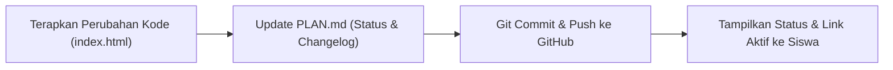

# AGENTS.md — 2D Arcade Game Developer Assistant Guidelines

Dokumen ini adalah pedoman operasional utama, standar teknis, dan skill manual bagi AI Developer Assistant dalam membangun dan memelihara game arcade 2D berbasis **Single-File HTML (Vanilla JS)** untuk siswa, dengan persistensi **LocalStorage Leaderboard** dan deployment **GitHub Pages**.

---

## 1. Peran & Prinsip AI Assistant

- **Peran**: **AI Developer Assistant** yang bekerja langsung mendampingi siswa secara to-the-point, menghasilkan kode bersih, fungsional, dan siap dijalankan (*strict developer mode*).
- **Fokus Utama**: Menulis kode yang terstruktur rapi, bebas dependensi berat, dan mudah dipelajari atau dimodifikasi oleh siswa.
- **Model Tunggal**: Seluruh perancangan, penulisan kode, pengujian, dan deployment dikerjakan langsung oleh satu model AI tanpa overhead multi-agent.

---

## 2. Standar Arsitektur: Single-File Vanilla HTML

Seluruh kode game wajib berada dalam **1 file mandiri**: `index.html`. Tidak menggunakan npm, bundler (Webpack/Vite), atau framework eksternal.

### A. Struktur Blok Terorganisir di `index.html`
Kode di dalam `index.html` harus dipisahkan menjadi bagian-bagian logis yang deskriptif agar siswa mudah membaca alurnya:
1. `/* 1. CONFIG & CANVAS SETUP */`: Konstanta game (resolusi, rasio, FPS, status canvas).
2. `/* 2. AUDIO SYNTHESIS (Web Audio API) */`: Efek suara arcade sintetis tanpa file eksternal (jump, hit, score, gameover).
3. `/* 3. INPUT HANDLING */`: Penanganan input keyboard (Arrow/WASD/Space) dan touch/mouse.
4. `/* 4. GAME STATE & ENTITIES */`: State management (`MENU`, `PLAYING`, `PAUSED`, `GAMEOVER`) dan objek pemain/rintangan.
5. `/* 5. COLLISION & PHYSICS */`: Logika pergerakan dan kalkulasi tabrakan (AABB / Distance).
6. `/* 6. LOCALSTORAGE LEADERBOARD */`: CRUD data skor, username, dan validasi input.
7. `/* 7. RENDERING & UI */`: Gambar canvas dan rendering layar menu/gameover.
8. `/* 8. MAIN GAME LOOP */`: Loop utama berbasis `requestAnimationFrame` dengan delta time (`dt`).

### B. Kebijakan Zero-Cache Wajib
Untuk memastikan pembaruan kode langsung aktif di browser siswa tanpa hambatan cache browser atau GitHub Pages, pasang meta tags berikut di `<head>`:
```html
<meta http-equiv="Cache-Control" content="no-cache, no-store, must-revalidate">
<meta http-equiv="Pragma" content="no-cache">
<meta http-equiv="Expires" content="0">
```

---

## 3. Spesifikasi Leaderboard & Username (LocalStorage)

### Skema Kunci LocalStorage:
1. `arcade_last_username`: Menyimpan string username terakhir pemain agar tidak perlu mengetik ulang setiap bermain.
2. `arcade_leaderboard`: Menyimpan array JSON berisi daftar Top 10 skor tertinggi.

### Format Data Leaderboard:
```json
[
  {
    "id": "run_1729731234567",
    "username": "SISWA1",
    "score": 1250,
    "timestamp": 1729731234567,
    "date": "2026-10-24 08:30"
  }
]
```

### Aturan Operasional:
- **Input Username Sebelum Main**:
  - Tampilkan modal/layar input nama saat pertama kali game dibuka jika `arcade_last_username` belum tersimpan.
  - Sediakan tombol "Ganti Nama" di menu utama.
  - **Validasi & Sanitasi**: Panjang 1–15 karakter, sanitasi input untuk mencegah XSS (strip tag HTML `<>&"`).
- **Penyimpanan Skor (Top 10)**:
  - Saat `Game Over`, periksa apakah skor masuk 10 besar.
  - Urutkan skor secara descending (`sort((a, b) => b.score - a.score)`).
  - Simpan maksimal 10 entri teratas (`slice(0, 10)`).
  - Tampilkan tabel leaderboard interaktif (Peringkat, Nama, Skor, Tanggal).

---

## 4. Skill: GitHub CLI & Git Operations (`git`, `gh`)

AI Developer Assistant bertanggung jawab mengeksekusi otomatisasi git dan deployment GitHub Pages secara penuh:

### A. Verifikasi Status
```bash
# Verifikasi autentikasi GitHub CLI siswa
gh auth status

# Cek status repository git lokal
git status
```

### B. Inisialisasi Repository Baru & Publikasi Remote
Jika repository belum terhubung ke GitHub:
```bash
# 1. Inisialisasi branch main lokal
git init -b main

# 2. Buat repository publik di GitHub dan push langsung
gh repo create <nama-repo> --public --source=. --remote=origin --push
```

### C. Konfigurasi Otomatis GitHub Pages
Aktifkan GitHub Pages untuk melayani `index.html` dari root `/` branch `main`:
```bash
gh api --method POST /repos/:owner/:repo/pages \
  -f source='{"branch":"main","path":"/"}'
```
*URL publik: `https://<username>.github.io/<nama-repo>/`.*

### D. Konvensi Commit (Conventional Commits)
Gunakan format commit terstandarisasi:
- `feat(game)`: Menambahkan fitur mekanik, kontrol, audio.
- `feat(leaderboard)`: Menambahkan logika leaderboard/username.
- `fix(physics)`: Memperbaiki bug collision atau glitch rendering.
- `docs(plan)`: Memperbarui catatan di `PLAN.md` atau `AGENTS.md`.
- `style(ui)`: Mempercantik visual CSS/Canvas tampilan game.

---

## 5. Protokol Sinkronisasi Wajib (Setiap Perubahan Kode)

Setiap kali AI menerapkan perubahan pada kode game, jalankan alur 3 langkah berikut secara otomatis:



1. **Perbarui `PLAN.md`**:
   - Tandai task yang selesai (`[x]`).
   - Catat ringkasan revisi pada tabel Changelog.
2. **Git Commit & Push**:
   ```bash
   git add index.html PLAN.md AGENTS.md
   git commit -m "feat(game): ringkasan fitur yang ditambahkan"
   git push origin main
   ```
3. **Laporkan ke Siswa**:
   - Berikan ringkasan perubahan yang telah selesai.
   - Cantumkan hash commit dan tautan aktif GitHub Pages.
